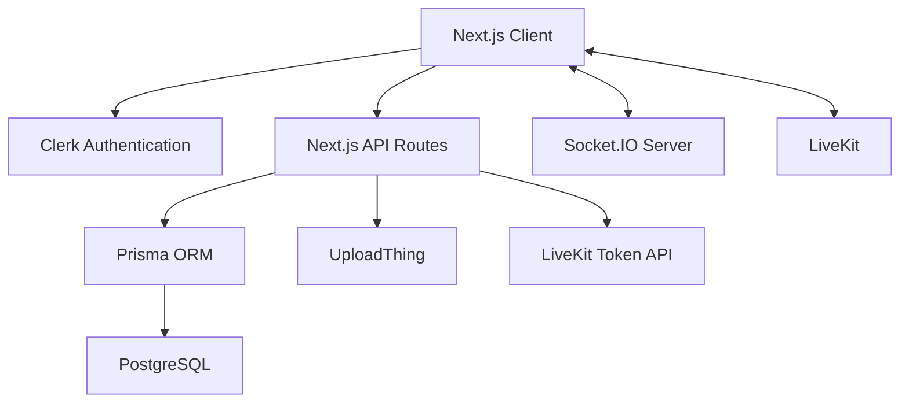

# OpsRoom

OpsRoom is a real-time collaboration platform built for teams that need one place to communicate, coordinate incidents, share operational files, and join live audio or video rooms.

The project started as a Discord-style communication application and evolved into an operations-focused workspace. Instead of separating chat, incident coordination, file sharing, and calls across multiple tools, OpsRoom brings those workflows together in a single interface.

## Demo

A full project demonstration is available here:

[Watch the OpsRoom demo]()

## What OpsRoom Supports

OpsRoom allows users to:

- Create and manage team workspaces
- Invite other users through generated invitation links
- Organize communication into text, audio, and video channels
- Exchange messages in real time
- Start private one-on-one conversations
- Upload images and PDF documents
- Edit and delete messages
- Delete a message only for themselves or for everyone
- Manage members using role-based permissions
- Join live audio and video rooms
- Switch between light and dark themes

## Main Features

### Authentication

Authentication is handled through Clerk.

Users can securely create an account, sign in, switch accounts, and access only the workspaces in which they are members. Protected pages and API routes verify the active user before returning workspace or message data.

### Workspace Management

Authenticated users can create their own OpsRoom workspace with a custom name and image.

Workspace owners can:

- Edit workspace details
- Generate invitation links
- Regenerate expired or compromised invitation links
- Manage workspace members
- Assign member roles
- Remove members
- Create and manage channels
- Delete the workspace

Users who are not the workspace owner can leave the workspace without affecting other members.

### Invitation System

Each workspace has a unique invitation code.

A user can open an invitation link, authenticate, and join the corresponding workspace. If the invitation code is no longer valid, OpsRoom displays an expired-invitation message rather than attempting to join an unavailable workspace.

Membership changes are synchronized so existing users can see newly joined or departed members without manually refreshing the page.

### Role-Based Permissions

OpsRoom includes three member roles:

| Role | Permissions |
|---|---|
| Admin | Full workspace, channel, and member management |
| Moderator | Channel management and selected moderation capabilities |
| Guest | Messaging, file sharing, direct messages, and calls |

Permission checks are enforced on the server instead of relying only on hidden client-side buttons.

### Channel Types

A workspace can contain three types of channels:

#### Text channels

Text channels support real-time team communication, message history, file uploads, message editing, and deletion.

#### Audio channels

Audio channels provide live voice communication through LiveKit.

#### Video channels

Video channels provide live camera, microphone, participant, and screen-sharing controls through LiveKit.

Channel names and types can be updated by authorized members. Channel creation, editing, and deletion events are synchronized across connected users.

### Real-Time Messaging

Real-time communication is implemented with Socket.IO.

When a message is created, edited, or deleted, the server emits an event for the active channel or conversation. Connected clients update their TanStack Query cache, allowing changes to appear without a full browser refresh.

If the socket connection is unavailable, the application can fall back to periodic message refetching.

### Workspace Synchronization

OpsRoom also uses server-level Socket.IO rooms for workspace changes.

The following actions can update other connected accounts automatically:

- Creating a channel
- Editing a channel
- Deleting a channel
- Joining through an invitation
- Leaving a workspace
- Changing a member’s role
- Removing a member

This is separate from message-level synchronization and keeps the workspace sidebar consistent for all connected users.

### Message History

Messages are loaded in batches using cursor-based pagination.

TanStack Query manages the paginated data and provides an efficient way to load previous messages without requesting the full conversation history every time a user opens a channel.

### Direct Messages

Users can select another workspace member to open a private conversation.

OpsRoom finds an existing conversation between the two members or creates one if no conversation currently exists. Direct messages use the same real-time infrastructure as channel messages.

### Message Editing

Message authors can edit their own text messages.

Edited messages are updated in the database and broadcast to connected clients. The interface adds an `(edited)` indicator so other users can see that the original content was modified.

File messages cannot be edited as regular text messages.

### Message Deletion

OpsRoom supports two message deletion modes inspired by modern messaging applications.

#### Delete for me

This hides the selected message only for the current user. Other participants can continue to see it.

User-specific deletion records are stored separately, allowing the original message to remain available to other members.

#### Delete for everyone

Only the original sender can delete a message for everyone.

The message is marked as deleted and its content is replaced with a deletion notice. The update is broadcast to connected users in real time.

Recipients cannot permanently remove another user’s message for everyone.

### File Sharing

File uploads are handled through UploadThing.

Users can share:

- Images
- PDF documents
- Operational reports
- Monitoring screenshots
- Incident-related attachments

Images appear directly inside the conversation. PDF files display as a document card containing the filename and a link to open the document.

### Emoji Support

Users can open the emoji picker and insert emojis directly into messages.

### Audio and Video Rooms

Live audio and video communication is powered by LiveKit.

The server generates short-lived access tokens for authenticated users. A token grants permission to join the requested room and publish or subscribe to audio and video tracks.

The custom conference interface includes:

- Participant tiles
- Camera controls
- Microphone controls
- Screen sharing
- Audio rendering
- Leave-room controls

### Light and Dark Themes

OpsRoom supports light and dark appearance modes through `next-themes`.

The selected theme is applied throughout workspaces, conversations, forms, modals, and call interfaces.

## Technology Stack

### Frontend

- Next.js
- React
- TypeScript
- Tailwind CSS
- shadcn/ui
- React Hook Form
- Zod
- TanStack Query
- Zustand
- Lucide React
- next-themes

### Backend

- Next.js App Router
- Next.js API routes
- Custom Node.js HTTP server
- Socket.IO
- Prisma ORM
- PostgreSQL

### Authentication and Services

- Clerk — authentication and user management
- Neon — PostgreSQL database hosting
- UploadThing — image and document uploads
- LiveKit — audio and video rooms

## Architecture



### Message flow

1. An authenticated user sends a message.
2. The corresponding API route validates the user and workspace membership.
3. Prisma saves the message in PostgreSQL.
4. The API route emits a Socket.IO event.
5. Connected clients receive the event.
6. TanStack Query updates the local message cache.
7. The new message appears without reloading the page.

## Database Design

The Prisma schema contains the following primary models:

- `Profile`
- `Server`
- `Member`
- `Channel`
- `Message`
- `Conversation`
- `DirectMessage`
- `MessageDeletion`
- `DirectMessageDeletion`

### Important relationships

- A profile can create multiple workspaces.
- A profile can become a member of multiple workspaces.
- A workspace contains members and channels.
- A channel contains messages.
- A conversation connects two workspace members.
- A conversation contains direct messages.
- Message deletion records track which messages are hidden for specific users.

## Project Structure

```text
OpsRoom/
├── app/
│   ├── (auth)/
│   ├── (invite)/
│   ├── (main)/
│   ├── (setup)/
│   └── api/
├── components/
│   ├── chat/
│   ├── modals/
│   ├── navigation/
│   ├── providers/
│   ├── server/
│   └── ui/
├── hooks/
├── lib/
├── pages/
│   └── api/
│       └── socket/
├── prisma/
│   ├── migrations/
│   └── schema.prisma
├── public/
├── proxy.ts
├── server.mjs
├── next.config.ts
├── package.json
└── types.ts
```

## Local Installation

### Prerequisites

Before running the project, install or create:

- Node.js 20 or newer
- npm
- PostgreSQL database
- Clerk account
- UploadThing account
- LiveKit Cloud project

### Clone the repository

```bash
git clone https://github.com/Mahee1911/OpsRoom.git
cd OpsRoom
```

### Install dependencies

```bash
npm install
```

### Configure environment variables

Create a `.env` file in the project root.

```env
DATABASE_URL=

NEXT_PUBLIC_CLERK_PUBLISHABLE_KEY=
CLERK_SECRET_KEY=

NEXT_PUBLIC_CLERK_SIGN_IN_URL=/sign-in
NEXT_PUBLIC_CLERK_SIGN_UP_URL=/sign-up

UPLOADTHING_TOKEN=

LIVEKIT_API_KEY=
LIVEKIT_API_SECRET=
NEXT_PUBLIC_LIVEKIT_URL=

NEXT_PUBLIC_SITE_URL=http://localhost:3000
```

Never commit real environment values or credentials to GitHub.

### Generate the Prisma client

```bash
npx prisma generate
```

### Synchronize the database

For a new development database:

```bash
npx prisma db push
```

If the project is using migration history:

```bash
npx prisma migrate dev
```

Do not run `prisma migrate reset` against a database containing important data because it deletes existing records.

### Start the development server

```bash
npm run dev
```

Open:

```text
http://localhost:3000
```

The project uses a custom Node.js server so Next.js and Socket.IO can share the same HTTP server.

## Available Scripts

| Command | Description |
|---|---|
| `npm run dev` | Starts the application in development mode |
| `npm run build` | Creates a production build |
| `npm run start` | Starts the production server |
| `npm run lint` | Runs ESLint |
| `npx prisma generate` | Regenerates Prisma Client |
| `npx prisma db push` | Synchronizes the schema with the database |
| `npx prisma studio` | Opens Prisma Studio |

## Security Considerations

OpsRoom includes server-side authorization checks for workspace membership and message ownership.

The project also follows these practices:

- Environment variables are excluded from version control.
- Database credentials remain server-side.
- LiveKit API secrets are used only when generating tokens on the server.
- Clerk secret keys are never exposed to client components.
- API routes verify the authenticated profile.
- Workspace membership is checked before accessing messages.
- Message ownership is verified before editing or deleting for everyone.
- Uploaded files are handled through UploadThing.
- User-generated text is rendered through React rather than inserted as raw HTML.

For a production deployment, additional rate limiting, logging, monitoring, and automated security testing would be recommended.

## Design Decisions

### Why Socket.IO?

Socket.IO provides a straightforward event-based system for messages and workspace updates. It also provides automatic reconnection behavior and works well with the custom Node.js server used by the project.

### Why TanStack Query?

TanStack Query manages message fetching, cursor-based pagination, caching, and real-time cache updates. This prevents the application from refetching an entire conversation whenever one message changes.

### Why Prisma?

Prisma provides a typed database client and keeps the PostgreSQL schema closely connected to the TypeScript application.

### Why separate deletion records?

A single `deleted` field is sufficient for “delete for everyone,” but it cannot represent a message hidden by only one participant.

The `MessageDeletion` and `DirectMessageDeletion` models store user-specific deletion state without removing the original message for everyone else.

### Why a custom server?

The custom `server.mjs` file allows Next.js and Socket.IO to use the same HTTP server and socket path. This supports bidirectional communication while preserving the rest of the Next.js application structure.

## Challenges and Lessons Learned

A few areas required additional debugging and design work:

### Real-time updates between separate accounts

Refreshing the sender’s page was not enough because `router.refresh()` only affects the browser that initiated the action. Server-specific Socket.IO rooms were added so channel and membership changes could update other connected accounts.

### Query cache consistency

The TanStack Query key used by message fetching needed to exactly match the key used by Socket.IO cache updates. A mismatch caused messages to appear only after refreshing.

### User-specific deletion

“Delete for me” could not be implemented by changing the original message because that would affect every participant. Separate deletion models and query filters were introduced to preserve individual visibility.

### LiveKit participant layouts

The default video conference layout produced camera-placeholder synchronization errors in some cases. A custom participant layout was added using LiveKit track references and participant tiles.

### File-type detection

New UploadThing file URLs do not always include the original extension. Filename metadata was preserved so PDF documents could be displayed as file cards rather than broken image previews.

## Future Improvements

Potential future additions include:

- Message reactions
- Reply threads
- Message pinning
- Typing indicators
- Read receipts
- Online and offline presence
- Notification preferences
- Incident severity labels
- Incident timelines
- Audit logs
- Full-text message search
- Workspace analytics
- Automated tests
- Rate limiting
- Docker support
- Production deployment documentation

## Purpose

OpsRoom was developed as a full-stack portfolio project to explore:

- Real-time client/server communication
- Authentication and authorization
- Relational database design
- Server and client component boundaries
- Optimistic and event-driven UI updates
- Secure file handling
- Audio and video communication
- Multi-user workspace synchronization

## Acknowledgments

OpsRoom was developed as a full-stack learning and portfolio project focused on real-time communication, multi-user workspace synchronization, role-based access, file sharing, and live audio/video collaboration.

## Author

**Mahee Gadhiya**

- GitHub: [Mahee1911](https://github.com/Mahee1911)
- Project: [OpsRoom](https://github.com/Mahee1911/OpsRoom)

## Project Status

OpsRoom is currently a completed portfolio project. Additional improvements and production-focused features may be added in the future.